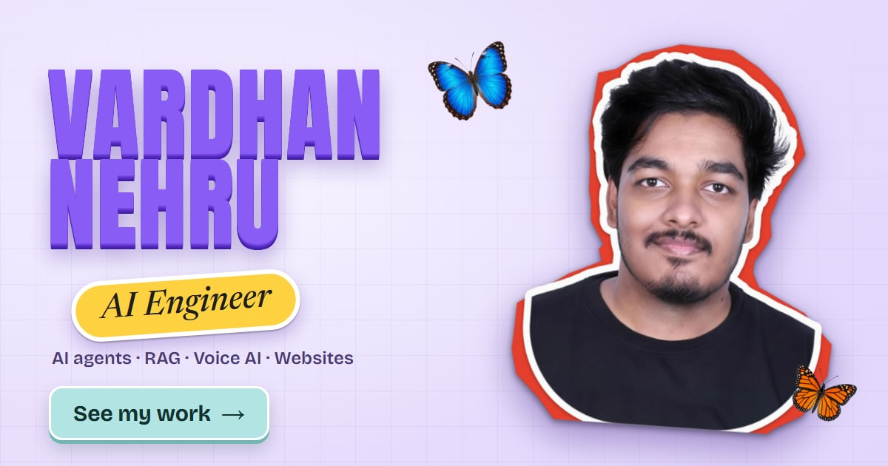

# Vardhan Nehru — Portfolio

**Live: [vardhannehru.github.io](https://vardhannehru.github.io)**



My personal portfolio as an AI Engineer: AI agents, RAG chatbots, real-time voice AI and websites, each with how it
works and what it's made of.

## Built with

React 19, Vite, Tailwind CSS, three.js, GSAP and Framer Motion. Illustrations and the butterflies were made with
Higgsfield; full credits are on the site's [Credits](https://vardhannehru.github.io/credits) page.

## Run it locally

Needs Node.js.

```bash
npm install
npm run dev
```

## Deploy

Every push to `main` builds the site and publishes it to GitHub Pages (`.github/workflows/deploy.yml`).
